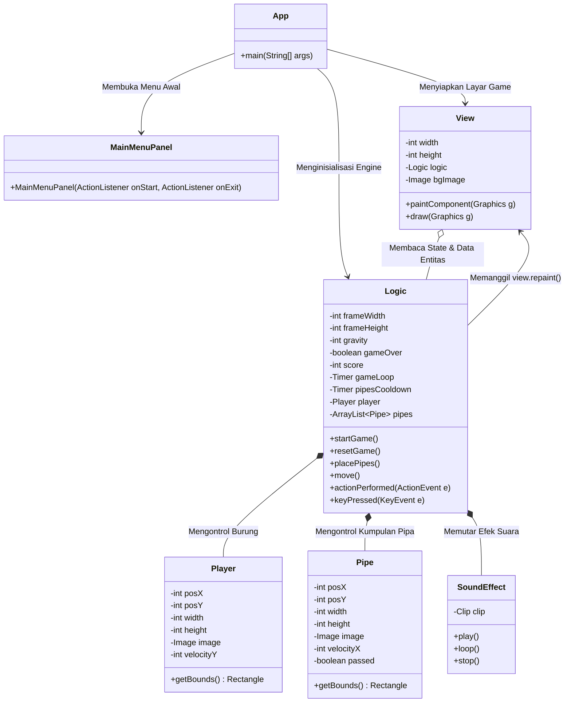

# 🐦 Tugas Praktikum 6 (TP6) - Flappy Bird 2D Game

Repositori ini memuat implementasi game 2D **Flappy Bird** berbasis desktop yang dibangun menggunakan bahasa pemrograman **Java** dan pustaka GUI **Java Swing**. Proyek ini dikembangkan untuk memenuhi penugasan **Tugas Praktikum 6 (TP6) Pemrograman Berbasis Objek (DPBO)** dengan menerapkan arsitektur modular (*Model-View-Controller* / MVC), manajemen layout multitampilan (*CardLayout*), deteksi tabrakan presisi (*bounding box intersection*), serta sistem pemutaran efek suara (*sound effects*).

---

## 📑Janji

Saya Muhiban Fadlan Nursaid dengan NIM 2400382 mengerjakan evaluasi Tugas Praktikum 5 dalam mata kuliah Desain dan Pemrograman Berorientasi Objek untuk keberkahan-Nya maka saya tidak melakukan kecurangan seperti yang telah dispesifikasikan. Aamiin.

---
## 📑 Daftar Isi

- [Fitur & Spesifikasi](#-fitur--spesifikasi)
- [Struktur Folder](#-struktur-folder)
- [Arsitektur & Struktur Kelas](#-arsitektur--struktur-kelas)
- [Alur Kerja Sistem (Workflow)](#-alur-kerja-sistem-workflow)
- [Detail Mekanisme Teknis](#-detail-mekanisme-teknis)
- [Kontrol Permainan](#-kontrol-permainan)
- [Panduan Menjalankan Proyek](#-panduan-menjalankan-proyek)

---


## ✨ Fitur & Spesifikasi

### 📋 Spesifikasi Wajib
| Fitur | Deskripsi |
| :--- | :--- |
| **Main Menu Navigation** | Layar awal berbasis `GridBagLayout` dengan tombol **Start Game** untuk masuk ke gameplay dan **Exit** untuk keluar aplikasi. Navigasi antar layar ditangani secara mulus melalui `CardLayout`. |
| **Siklus Game Loop (60 FPS)** | Menggunakan `javax.swing.Timer` yang menembak setiap ~16.6ms untuk memperbarui fisika gerakan secara halus dan memicu perenderan ulang (*repaint*). |
| **Fisika Gravitasi & Lompatan** | Simulasi gaya gravitasi realistis (akselerasi `+1` per frame) serta dorongan vertikal instan (`-10` piksel) saat tombol lompat ditekan. Batas atas layar dikunci agar burung tidak keluar dari frame. |
| **Rintangan Pipa Prosedural** | Pipa atas dan pipa bawah dibuat berpasangan secara berkala setiap 1.5 detik dengan ketinggian celah (*gap*) yang diacak secara proporsional. |
| **Collision Detection Presisi** | Deteksi tabrakan menggunakan perpotongan kotak pembatas (*hitbox bounding box* melalui `Rectangle.intersects()`) antara burung dan pipa, serta deteksi jatuh ke batas bawah jendela (*bottom frame collision*). |
| **Sistem Penskoran Otomatis** | Skor bertambah secara otomatis setiap kali burung berhasil melintasi sepasang pipa tanpa tabrakan. Status `passed` mencegah penghitungan ganda. |
| **Game Over Overlay & Restart** | Layar gelap semi-transparan yang menampilkan status *Game Over*, skor akhir, dan instruksi memulai ulang. Permainan dapat langsung diulang dengan menekan tombol **R**. |

### 🌟 Fitur Bonus (+20 Poin)
| Komponen Audio | Keterangan |
| :--- | :--- |
| **Jump Sound (`jump.wav`)** | Efek suara terdengar saat tombol <kbd>Space</kbd> ditekan untuk mengepakkan sayap burung. |
| **Score Sound (`score.wav`)** | Efek suara konfirmasi saat pemain berhasil melewati satu rintangan pipa. |
| **Hit / Death Sound (`hit.wav`)** | Efek suara benturan saat burung menabrak pipa atau jatuh menyentuh tanah. |

---

## 📂 Struktur Folder

Berikut adalah visualisasi susunan direktori dan berkas pada repositori ini:

```text
TP6DPBO2526C1/
├── src/
│   ├── assets/
│   │   ├── background.png
│   │   ├── bird.png
│   │   ├── lowerPipe.png
│   │   ├── upperPipe.png
│   │   ├── hit.wav
│   │   ├── jump.wav
│   │   └── score.wav
│   ├── App.java
│   ├── Logic.java
│   ├── MainMenuPanel.java
│   ├── Pipe.java
│   ├── Player.java
│   ├── SoundEffect.java
│   └── View.java
├── Dokumentasi/
│   └── Dokumentasi.mkv
├── .gitignore
└── README.md
```

---

## 🏛️ Arsitektur & Struktur Kelas

Proyek ini dirancang dengan memisahkan representasi data (*Model*), tampilan grafis (*View*), dan pengendali logika game (*Controller/Engine*):



### Penjelasan Rinci Peran Kelas:

| Nama Berkas | Lapisan Arsitektur | Tanggung Jawab & Deskripsi Rinci |
| :--- | :--- | :--- |
| **`App.java`** | **Application Entry Point** | Menginisialisasi `JFrame` berdimensi tetap ($360 \times 640\text{ px}$), mengatur penempatan jendela di tengah layar, mengonfigurasi `CardLayout`, serta menghubungkan keterikatan dua arah antara `Logic` dan `View`. Menghubungkan *event callback* tombol menu ke aktivasi gameplay. |
| **`MainMenuPanel.java`** | **UI / Menu Screen** | Mengatur tata letak tampilan pembuka aplikasi (*Title screen*) menggunakan `GridBagLayout`. Menampilkan teks judul *"FLAPPY BIRD"*, tombol *Start Game*, dan tombol *Exit* dengan gaya visual serasi berlatar *Steel Blue*. |
| **`View.java`** | **View (Presentation Layer)** | Turunan dari `JPanel` yang bertugas melakukan penggambaran (*rendering*) setiap frame dengan *double buffering*. Menggunakan *Painter's Algorithm* untuk menggambar urutan: **Background $\rightarrow$ Pipa $\rightarrow$ Player $\rightarrow$ HUD Skor / Overlay Game Over**. |
| **`Logic.java`** | **Controller / Game Engine** | Mengatur seluruh aturan permainan (*game rules*). Mengimplementasikan `ActionListener` untuk *Game Loop* (60 FPS) dan *Pipe Spawner Timer* (1.5 detik), serta `KeyListener` untuk input keyboard. Mengkalkulasi perpindahan objek, percepatan gravitasi, deteksi tabrakan, dan akumulasi poin. |
| **`Player.java`** | **Model (Entity)** | Merepresentasikan karakter burung Flappy Bird. Menyimpan koordinat $(X, Y)$, dimensi ukuran $(W, H)$, sprite gambar, kecepatan vertikal (`velocityY`), dan menyediakan objek `Rectangle` (*bounding box*) untuk deteksi tabrakan. |
| **`Pipe.java`** | **Model (Entity)** | Merepresentasikan satu segmen pipa rintangan (atas/bawah). Menyimpan koordinat, kecepatan translasi horizontal (`velocityX = -2`), status lewati (`passed`), serta metode `getBounds()` untuk keperluan *collision checking*. |
| **`SoundEffect.java`** | **Utility (Audio Engine)** | Kelas pembantu berbasis `javax.sound.sampled` yang memuat audio dari *classpath* ke memori RAM dalam bentuk objek `Clip`. Menyediakan pemutaran suara nir-latensi (*zero-latency playback*) dari awal berkas melalui pemanggilan `play()`. |

---

## 🔄 Alur Kerja Sistem (Workflow)

Berikut adalah diagram alir siklus hidup (*lifecycle*) permainan dari aplikasi saat dijalankan hingga berakhir:

```mermaid
flowchart TD
    Start([Mulai: App.java]) --> InitComponents[Inisialisasi Frame 360x640\nLoad Assets & Setup CardLayout]
    InitComponents --> ShowMenu[Tampilkan MainMenuPanel]

    ShowMenu --> UserChoice{Interaksi Menu}
    UserChoice -- Klik Exit --> TerminateApp([Keluar Aplikasi System.exit])
    UserChoice -- Klik Start Game --> SwitchToGame[CardLayout berpindah ke GAME\nFokus ke View & Jalankan Logic.startGame]

    SwitchToGame --> InitLoop[Aktifkan Game Loop Timer 60 FPS\nAktifkan Pipes Cooldown Timer 1.5s]

    InitLoop --> GameCycle[Game Loop Iterasi ~16ms]

    subgraph GameLoop[" Siklus Frame Game (Game Loop) "]
        GameCycle --> InputCheck{Input Keyboard?}
        InputCheck -- Tekan Spasi --> JumpAction[Set velocityY = -10\nPutar jump.wav]
        InputCheck -- Tidak Ada --> ApplyGravity[Terapkan Gravitasi: velocityY += 1]
        JumpAction --> ApplyGravity

        ApplyGravity --> UpdatePos[Perbarui Posisi Y Burung\nKunci batas atas posY >= 0]
        UpdatePos --> MovePipes[Geser Posisi X Semua Pipa sebesar -2px]

        MovePipes --> CheckPassed{Burung melewati pipa\n& belum passed?}
        CheckPassed -- Ya --> AddScore[Score += 1\nSet pipe.passed = true\nPutar score.wav]
        CheckPassed -- Tidak --> CollisionCheck
        AddScore --> CollisionCheck

        CollisionCheck{Deteksi Tabrakan?}
        CollisionCheck -- Tabrak Pipa ATAU\nMenyentuh Dasar Layar --> TriggerGameOver[Pemicu Game Over]
        CollisionCheck -- Aman --> RepaintView[Panggil view.repaint\nRender Background, Pipa, Burung, Skor]
        RepaintView --> GameCycle
    end

    TriggerGameOver --> StopTimers[Hentikan gameLoop & pipesCooldown\nPutar hit.wav\nSet gameOver = true]
    StopTimers --> RenderGameOver[View menggambar Overlay Hitam Transparan,\nTeks GAME OVER, Skor Akhir, dan Instruksi Restart]

    RenderGameOver --> GameOverInput{Menunggu Input}
    GameOverInput -- Tekan Tombol R --> ResetGame[Panggil resetGame\nKembalikan posisi burung, hapus pipa, reset skor ke 0]
    ResetGame --> InitLoop
```



### Tahapan Operasi Secara Terperinci:

1. **Inisialisasi Program (`App.java`)**:
   - `JFrame` dibuat berukuran $360 \times 640\text{ px}$, `resizable` dimatikan, dan posisi diatur ke tengah layar (`setLocationRelativeTo(null)`).
   - Objek `Logic` dibentuk (memuat sprite dan audio secara *eager* ke memori), kemudian dihubungkan dengan `View`.
   - `MainMenuPanel` didaftarkan pada `CardLayout` dengan kunci `"MENU"`, dan `View` didaftarkan dengan kunci `"GAME"`.

2. **Interaksi Menu Awal (`MainMenuPanel.java`)**:
   - Menu utama tampil pertama kali.
   - Apabila pemain menekan **Exit**, sistem memanggil `System.exit(0)`.
   - Apabila pemain menekan **Start Game**, `CardLayout` menampilkan panel `"GAME"`, meminta fokus keyboard pada `View`, dan memanggil metode `logika.startGame()`.

3. **Eksekusi Game Loop Aktif (`Logic.java` & `View.java`)**:
   - **Game Loop Timer**: Berjalan setiap $\frac{1000}{60}\text{ ms} \approx 16.6\text{ ms}$ (60 FPS), memicu metode `move()` dan `view.repaint()`.
   - **Pipe Spawner Timer**: Setiap $1500\text{ ms}$ (1.5 detik), metode `placePipes()` menambahkan sepasang objek `Pipe` (atas dan bawah) dengan variasi celah vertikal sebesar 160 piksel.
   - **Perhitungan Fisika**:
     - Gravitasi konstan $+1\text{ px/frame}^2$ ditambahkan ke `velocityY` burung.
     - Posisi vertikal burung diperbarui: `posY += velocityY`.
     - Pipa bergeser ke arah kiri: `posX += pipeVelocityX` (di mana kecepatan bernilai `-2`).
   - **Input Lompat**: Penekanan tombol <kbd>Space</kbd> memberikan impuls ke atas secara instan dengan mengubah `velocityY = -10` serta memainkan berkas audio `jump.wav`.
   - **Perhitungan Skor**: Saat koordinat X burung melampaui lebar sebuah pipa (`player.posX > pipe.posX + pipe.width`), atribut `passed` diubah menjadi `true`, skor mentah bertambah, dan berkas `score.wav` diputar.

4. **Deteksi Tabrakan & Game Over**:
   - Tabrakan diperiksa pada setiap iterasi frame melalui:
     - Benturan dengan batas bawah layar (`player.posY + player.height >= frameHeight`).
     - Perpotongan *bounding box* hitbox burung dengan rintangan (`player.getBounds().intersects(pipe.getBounds())`).
   - Saat tabrakan terdeteksi, `triggerGameOver()` dieksekusi: `gameOver` diatur ke `true`, audio `hit.wav` dimainkan, dan kedua timer dihentikan.
   - Layar `View` menampilkan panel overlay gelap semi-transparan berisikan teks merah bertuliskan **GAME OVER**, total perolehan skor akhir, dan instruksi penekanan tombol **R**.

5. **Mekanisme Restart (`resetGame`)**:
   - Saat dalam status *Game Over*, jika pemain menekan tombol <kbd>R</kbd>, sistem mengeksekusi `resetGame()`.
   - Posisi burung dikembalikan ke tengah layar (`posY = 320`), kecepatan vertikal dinolkan, semua pipa dihapus dari memori (`pipes.clear()`), skor di-reset menjadi `0`, dan timer permainan diaktifkan kembali.

---

## ⚙️ Detail Mekanisme Teknis

### 1. Bounding Box Collision
Deteksi tabrakan mengandalkan kelas `java.awt.Rectangle`. Setiap entitas mengekspos area kotak batas melalui `getBounds()`:
```java
// Logic.java
private boolean checkCollision(Player a, Pipe b) {
    return a.getBounds().intersects(b.getBounds());
}
```
Metode `intersects()` membandingkan proyeksi sumbu koordinat kedua bangun persegi secara instan tanpa membebani pemrosesan CPU.

### 2. Audio Engine (`SoundEffect.java`)
Menggunakan `Clip` dari paket standar `javax.sound.sampled`:
- File audio WAV dibaca langsung dari *classpath* melalui `getResourceAsStream`.
- Data audio diurai ke memori RAM, sehingga saat pemanggilan `play()` dilakukan, audio dapat diputar secara instan dengan mengatur *frame position* kembali ke 0 (`clip.setFramePosition(0)`).

### 3. Logika Penskoran Pasangan Pipa
Karena pipa dihasilkan berpasangan (pipa atas dan pipa bawah), setiap pipa yang terlewati akan menambah skor mentah sebesar 1. Pada antarmuka pengguna (`View.java`), angka skor ditampilkan dengan membagi 2 skor mentah (`logic.getScore() / 2`), memastikan pemain mendapatkan tepat **1 poin per rintangan** yang berhasil dilalui.

---

## 🎮 Kontrol Permainan

| Tombol | Konteks | Aksi |
| :---: | :--- | :--- |
| <kbd>Space</kbd> | Saat Gameplay Berlangsung | Mengepakkan sayap / membuat burung melompat ke atas |
| <kbd>R</kbd> | Saat Layar *Game Over* | Me-reset permainan dan memulai sesi baru dari awal |
| **Mouse Click** | Menu Utama | Menekan tombol interaktif **Start Game** atau **Exit** |

---

## 💻 Panduan Menjalankan Proyek

### Prasyarat Lingkungan
- **Java Development Kit (JDK)**: Versi 8 atau yang lebih baru (OpenJDK / Oracle JDK).
- Pastikan perintah `javac` dan `java` sudah terdaftar pada sistem *Environment Variables* (PATH).

### Opsi 1: Kompilasi & Jalankan Melalui Terminal (CLI)

1. **Buka terminal** pada direktori utama proyek (`TP6`).
2. **Kompilasi seluruh kode sumber** ke folder `bin`:
   ```bash
   javac -d bin src/*.java
   ```
3. **Salin aset multimedia** ke dalam folder `bin/assets` (jika belum ada) agar dapat diakses oleh *classpath loader*:
   - **Windows (Command Prompt / PowerShell)**:
     ```powershell
     if (!(Test-Path "bin\assets")) { New-Item -ItemType Directory -Path "bin\assets" }
     Copy-Item -Path "src\assets\*" -Destination "bin\assets\" -Recurse -Force
     ```
   - **Linux / macOS**:
     ```bash
     mkdir -p bin/assets
     cp -r src/assets/* bin/assets/
     ```
4. **Jalankan aplikasi**:
   ```bash
   java -cp bin App
   ```

### Opsi 2: Menjalankan Menggunakan IDE

- **Visual Studio Code**:
  1. Pasang ekstensi *Extension Pack for Java*.
  2. Buka folder `TP6` pada VS Code.
  3. Buka file `src/App.java` lalu klik tombol **Run** atau tekan <kbd>F5</kbd>.
- **IntelliJ IDEA**:
  1. Buka folder direktori proyek `TP6`.
  2. Tandai folder `src` sebagai *Sources Root* (Klik kanan `src` $\rightarrow$ *Mark Directory as* $\rightarrow$ *Sources Root*).
  3. Buka berkas `App.java` dan klik ikon panah hijau **Run 'App.main()'**.
- **NetBeans / Eclipse**:
  1. Buat *Java Project with Existing Sources*.
  2. Arahkan *Source Folder* ke folder `src`.
  3. Jalankan kelas utama `App`.

---
